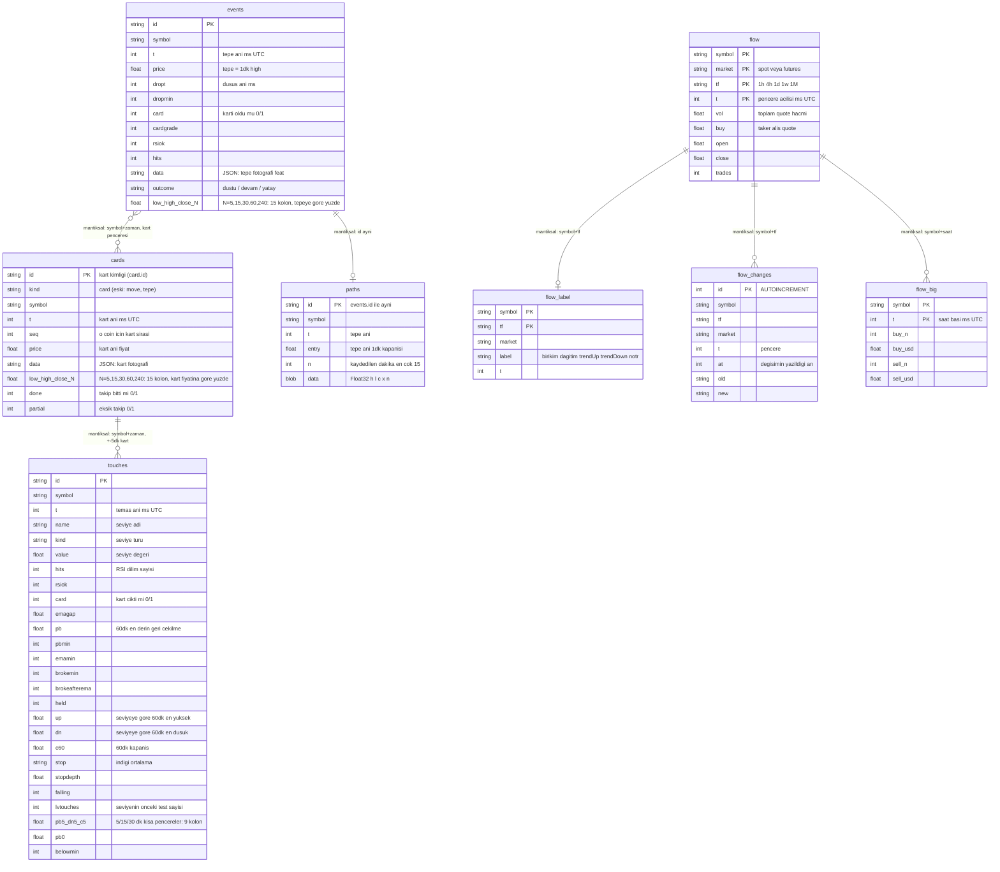
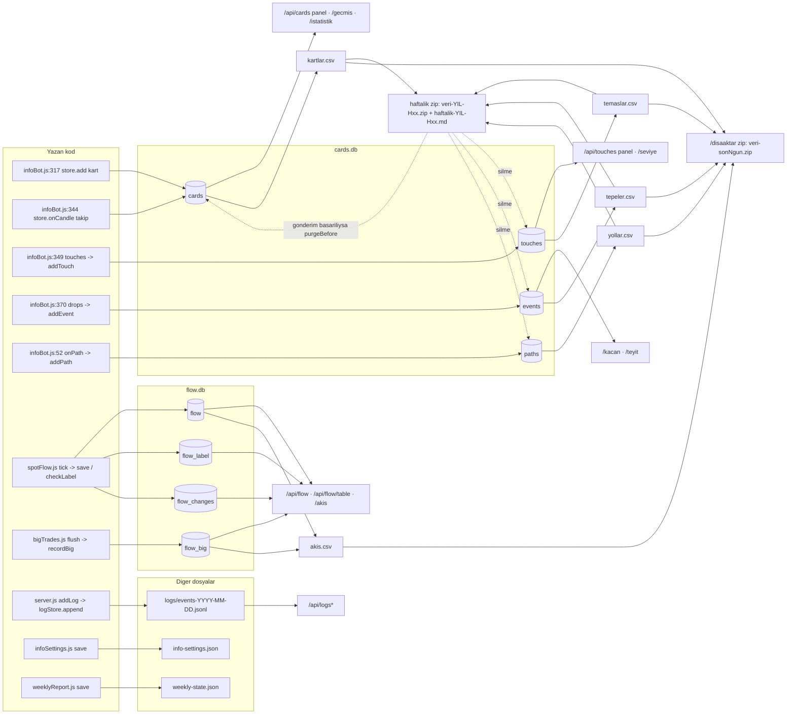

# Scalp Bilgi Botu — Veritabanı Şema Haritası

Esas sürüm: `origin/main` (d239a29). Bekleyen PR #24 (`pr24`, 23e2a20) ⏳ işaretiyle ayrıdır; ana gövdede yalnız main anlatılır, PR24 farkları her yerde "⏳" ile, toplu hâliyle [§5](#pr24) bölümünde verilir.
Kanıt biçimi: `[kanıt: dosya:satır]` = `git show origin/main:src/<dosya>` satır numarası; PR24 için `pr24:` öneki. Kanıt etiketleri 2026-11-25'te `origin/main` ve `pr24` üzerinde yeniden doğrulandı.
Bu belge salt okuma ile üretildi; depoda ve canlı sistemde hiçbir şey değiştirilmedi.

## İçindekiler

- [1. Kısa özet](#ozet)
  - [1.1 Adlandırma sözlüğü (1s / 1h / 1m / 1M, kind, tepe)](#adlandirma)
- [2. Diyagramlar](#diyagramlar)
  - [2.1 ER diyagramı](#er)
  - [2.2 Akış diyagramı: yazan kod → tablo → okuyan / CSV](#akis-diyagrami)
- [3. Tablo bölümleri](#tablolar)
  - cards.db: [3.1 `cards`](#t-cards) · [3.2 `touches`](#t-touches) · [3.3 `events`](#t-events) · [3.4 `paths`](#t-paths)
  - flow.db: [3.5 `flow`](#t-flow) · [3.6 `flow_label`](#t-flow-label) · [3.7 `flow_changes`](#t-flow-changes) · [3.8 `flow_big`](#t-flow-big)
  - [3.9 SQLite dışı dosyalar](#t-diger)
- [4. Haftalık rapor ve dışa aktarma (CSV özeti)](#csv)
  - CSV dosyaları: [kartlar.csv](#csv-kartlar) · [temaslar.csv](#csv-temaslar) · [tepeler.csv](#csv-tepeler) · [yollar.csv](#csv-yollar) · [akis.csv](#csv-akis)
- [5. ⏳ PR #24 — henüz birleşmedi](#pr24)
  - Maddeler: [1](#pr-1) · [2](#pr-2) · [3](#pr-3) · [4](#pr-4) · [5](#pr-5) · [6](#pr-6) · [7](#pr-7) · [8](#pr-8) · [9](#pr-9) · [toplu CSV etkisi](#pr-csv)
- [6. Dikkat notları ve tuhaflıklar](#notlar)
  - [6.1 Bellek ve parça parça okuma](#n-bellek) · [6.2 Haftalık silme](#n-silme) · [6.3 "Kolon adı değişmez" kuralı](#n-kural)
  - [6.4 Tuhaflıklar (kanıtlı)](#tuhaflik): [1](#tuh-1) · [2](#tuh-2) · [3](#tuh-3) · [4](#tuh-4) · [5](#tuh-5) · [6](#tuh-6) · [7](#tuh-7) · [8](#tuh-8) · [9](#tuh-9) · [10](#tuh-10) · [11](#tuh-11) · [12](#tuh-12) · [13](#tuh-13) · [14](#tuh-14)
  - [6.5 Doğrulanamayanlar](#dogrulanamayan)

**Çapraz bağlantı haritası** (her tablo bölümünün başındaki "İlişkili:" satırı bunun ayrıntısıdır):

| Tablo | CSV (§4) | PR #24 (§5) | Tuhaflık (§6.4) |
|---|---|---|---|
| [`cards`](#t-cards) | [kartlar.csv](#csv-kartlar) | [5](#pr-5), [6](#pr-6), [CSV](#pr-csv) | [4](#tuh-4), [5](#tuh-5), [9](#tuh-9) |
| [`touches`](#t-touches) | [temaslar.csv](#csv-temaslar) | [CSV (değişmez)](#pr-csv) | [3](#tuh-3), [6](#tuh-6) |
| [`events`](#t-events) | [tepeler.csv](#csv-tepeler) | [1](#pr-1), [2](#pr-2), [3](#pr-3), [4](#pr-4), [7](#pr-7), [8](#pr-8), [9](#pr-9), [CSV](#pr-csv) | [2](#tuh-2), [4](#tuh-4), [6](#tuh-6), [7](#tuh-7), [8](#tuh-8), [13](#tuh-13) |
| [`paths`](#t-paths) | [yollar.csv](#csv-yollar) | [CSV (değişmez)](#pr-csv) | yok (bkz. [§6.2](#n-silme)) |
| [`flow`](#t-flow) | [akis.csv](#csv-akis) | [CSV (değişmez)](#pr-csv) | [6](#tuh-6), [11](#tuh-11), [14](#tuh-14) |
| [`flow_label`](#t-flow-label) | yok | yok | [6](#tuh-6), [10](#tuh-10) |
| [`flow_changes`](#t-flow-changes) | yok | yok | [10](#tuh-10) |
| [`flow_big`](#t-flow-big) | [akis.csv](#csv-akis) (`big_*`) | yok | [6](#tuh-6), [14](#tuh-14) |
| [SQLite dışı dosyalar](#t-diger) | yok | yok | [1](#tuh-1) |

---

## 1. Kısa özet

Tüm kalıcı veri `/data` altındadır (Dockerfile `ENV DB_PATH=/data/signals.db`; kod bu yolun yalnız **klasörünü** kullanır) [kanıt: Dockerfile:39; cardStore.js:30-33; spotFlow.js:112-115; logStore.js:21-25; infoSettings.js:93-96].

| Dosya (`/data/…`) | Biçim | Tutulan | Yazan modül |
|---|---|---|---|
| `cards.db` | SQLite, `journal_mode = WAL` [kanıt: cardStore.js:45] | tablolar: [`cards`](#t-cards), [`touches`](#t-touches), [`events`](#t-events), [`paths`](#t-paths) | `src/cardStore.js` (+ `levelTouch.js`, `eventLog.js` çıktıları) |
| `flow.db` | SQLite, WAL [kanıt: spotFlow.js:134] | tablolar: [`flow`](#t-flow), [`flow_label`](#t-flow-label), [`flow_changes`](#t-flow-changes), [`flow_big`](#t-flow-big) | `src/spotFlow.js` (+ `bigTrades.js` → `recordBig`) |
| `logs/events-YYYY-MM-DD.jsonl` | satır başına bir JSON | uyarı/hata günlüğü (`{t, level, tag, message}`) | `src/logStore.js` [kanıt: logStore.js:7-9, 57-59] — bkz. [§3.9](#t-diger) |
| `info-settings.json` | JSON | `{ values, mutes, follows, topics }` — yalnız varsayılandan farklı ayarlar | `src/infoSettings.js` [kanıt: infoSettings.js:123-132] — bkz. [§3.9](#t-diger) |
| `weekly-state.json` | JSON | `{ lastSlot }` (haftalık rapor zamanlayıcı durumu) | `src/weeklyReport.js` [kanıt: weeklyReport.js:18, 234-243] — bkz. [§3.9](#t-diger) |
| `signals.db` | **YOK** (eski) | Kodda bu adla açılan SQLite yok | bkz. aşağıdaki not ve [§6.4-1](#tuh-1) |

**`signals.db` notu:** Kodda `signals.db` yalnız varsayılan `DB_PATH` değeri olarak geçer; dosya hiçbir yerde `new Database(...)` ile açılmaz. Gerçek yollar `path.dirname(DB_PATH)` + `cards.db` / `flow.db` / `logs` / `info-settings.json` / `weekly-state.json` olarak türetilir. Yani `signals.db` eski bir kalıntıdır: kodda yazan yok (Fly diskinde eski dosya duruyorsa doğrulanamadı — canlı sisteme bakılmadı). [kanıt: `git grep -n signals.db origin/main -- src` → cardStore.js:31, infoBot.js:793, infoSettings.js:94, logStore.js:23, spotFlow.js:113; hepsi yalnız `path.dirname(...)` için] `CARDS_DB_PATH`, `FLOW_DB_PATH`, `INFO_SETTINGS_PATH`, `LOG_DIR` ortam değişkenleri yolları ezer.

Hata davranışı: veritabanı açılamazsa ilgili özellik KAPANIR, bot sürer (`db = null`; `safe()` sarmalayıcısı yazma/okuma hatalarını loglar) [kanıt: cardStore.js:88-91, 115-118; spotFlow.js:155-158].

Tablo sayısı: **8 SQLite tablosu** (cards.db: 4, flow.db: 4) + 3 SQLite dışı kalıcı dosya türü (jsonl günlükleri, info-settings.json, weekly-state.json). `git grep -n "CREATE TABLE" origin/main -- src` yalnız şu 8 tabloyu verir: cards, touches, paths, events (cardStore.js:47,55,62,67) ve flow, flow_label, flow_changes, flow_big (spotFlow.js:136,141,144,150).

### 1.1 Adlandırma sözlüğü

CLAUDE.md ile kod aynı şeye farklı yazım kullanır; karışmasın diye:

| Yazım | Nerede | Anlamı |
|---|---|---|
| `1s`, `4s` | CLAUDE.md "İstatistik kaydı" → `flow.db` satırı ("1s 30 gün, 4s 180 gün, büyük işlem 400 gün") | Türkçe **s = saat**. Kodda aynı pencereler `tf = '1h'` ve `'4h'` olarak yazılır [kanıt: spotFlow.js:30 `TFS = ['1h','4h','1d','1w','1M']`; saklama spotFlow.js:33, 325]. Yani "1s 30 gün" = `flow` tablosunda `tf='1h'` satırları 30 gün, "4s 180 gün" = `tf='4h'` 180 gün. Ayrıntı: [§3.5](#t-flow), [§6.4-14](#tuh-14). |
| "büyük işlem 400 gün" | CLAUDE.md | [`flow_big`](#t-flow-big) saatlik sayaç satırları (`t` = saat başı), `1d` kapanışında `t < now − 400 gün` silinir [kanıt: spotFlow.js:172, 325]. `flow.tf` değeri değildir. |
| `1d`, `1w`, `1M` | `flow.tf` | 1 gün, 1 hafta, 1 **ay** (büyük `M` = ay). Bunlar için silme yok ([§6.4-14](#tuh-14)). |
| `1m`, `3m`, `5m`, `15m`, `1dk` | kart/tepe JSON alanları, belge metni | **Dakikalık** mum (küçük `m` = dakika); `1dk` = `1m`. `1M` (ay) ile karıştırma. `events.price` "1dk high", `paths.entry` "1dk kapanış" bu dakikalık mumdur. |
| `rsi1h`, `rsi4h`, `trend_1h`, `btc1h` | `cards.data` / `events.data` JSON | 1 saatlik / 4 saatlik mum göstergeleri ([§3.1](#t-cards), [§3.3](#t-events)); `flow` tablosundaki `tf` ile ilgisi yok. |
| `dk`, `sa`, `sn` | belge ve CLAUDE.md | dakika, saat, saniye. `low5…close240` kolonlarındaki sayı **dakikadır** (5/15/30/60/240 dk). |
| `kind` | `cards.kind` / `touches.kind` / CLAUDE.md "kind = tepe" | **Üç ayrı şey:** `cards.kind` = kart türü (`card`; eski kayıtlarda `move`, `tepe`); `touches.kind` = seviye türü; CLAUDE.md'deki "`kind = tepe` tepe bildirimleri" = `cards.kind = 'tepe'` (🔻 bildirim kartı, 24.11.2026'da kaldırıldı, [§6.4-5](#tuh-5)). |
| "tepe defteri" | CLAUDE.md, belge | [`events`](#t-events) tablosu (+ [`paths`](#t-paths)); `cards.kind = 'tepe'` kartlarından **bağımsızdır** — tepe defteri kaydı sürer. |
| `t`, `at` | tüm tablolar | `t` = olayın/pencerenin ms (UTC) zamanı; `flow_changes.at` = değişimin yazıldığı an. Kullanıcıya gösterim TSİ'dir. |
| `card` (kolon) | `touches.card`, `events.card` | 0/1 bayrak ("yakında kart çıktı mı"); [`cards`](#t-cards) **tablosu** değildir. |

---

## 2. Diyagramlar

### 2.1 ER diyagramı

Tablolar arasında **yabancı anahtar yoktur** (hiçbir CREATE TABLE'da `REFERENCES` yok). İlişkiler mantıksaldır: `symbol` + zaman (`t`) ya da aynı `id`. `⏳` olan kolon yoktur: PR #24 SQLite kolonu eklemez (bkz. [§5](#pr24)).
Diyagramdaki her tablonun ayrıntısı: [cards](#t-cards) · [touches](#t-touches) · [events](#t-events) · [paths](#t-paths) · [flow](#t-flow) · [flow_label](#t-flow-label) · [flow_changes](#t-flow-changes) · [flow_big](#t-flow-big).

Mantıksal ilişki kanıtları (her biri ilgili tablo bölümünden de bağlıdır):
- [`events`](#t-events) ↔ [`paths`](#t-paths): `paths.id` = `events.id` (aynı aday; `emitPath` `e.id` ile çağırır) [kanıt: eventLog.js:242-246; cardStore.js:195-196].
- [`events`](#t-events) ↔ [`cards`](#t-cards): `events.card/cardgrade` aynı sembolde `[t − cardBeforeMin, tepe penceresi sonu + cardAfterMin]` içindeki kartlardan türetilir; ayrı bir id bağı yoktur [kanıt: eventLog.js:179-181, 198-199].
- [`touches`](#t-touches) ↔ [`cards`](#t-cards): `touches.card` = temasın ±5 dk içinde kart çıktı mı; eşik `CARD_NEAR = 5` [kanıt: levelTouch.js:34 (`CARD_NEAR = 5`), :89 (kullanım), :12 (başlık yorumu "±5 dk içinde kart çıktı mı")].
- [`flow`](#t-flow) ↔ [`flow_big`](#t-flow-big): `rowsSince` büyük işlem saatlerini `windowStart(tf, t)` ile pencereye toplar [kanıt: spotFlow.js:396-404; fonksiyonun tamamı 394-415].
- [`flow`](#t-flow) ↔ [`flow_label`](#t-flow-label) ↔ [`flow_changes`](#t-flow-changes): `checkLabel` içinde birlikte güncellenir [kanıt: spotFlow.js:238-250].

### 2.2 Akış diyagramı: yazan kod → tablo → okuyan / CSV

Tablolar: [cards](#t-cards) · [touches](#t-touches) · [events](#t-events) · [paths](#t-paths) · [flow](#t-flow) · [flow_label](#t-flow-label) · [flow_changes](#t-flow-changes) · [flow_big](#t-flow-big) · [diğer dosyalar](#t-diger). CSV'ler: [§4](#csv).

Önemli: `akis.csv` yalnız `/disaaktar`'a girer ([§4](#csv-akis)); haftalık zip akış verisi içermez ve `flow.db` haftalık rapordan sonra **silinmez** [kanıt: weeklyReport.js — `buildWeekly` içinde `flow` geçmez (satır 104-225); exportData.js:83-84; cardStore.js:202-208]. Haftalık silme ayrıntısı: [§6.2](#n-silme).

---

## 3. Tablo bölümleri

Ortak not — **ekleme şekli** sütunu: `CREATE` = `CREATE TABLE IF NOT EXISTS` gövdesinde; `ADD COLUMN` = açılışta `PRAGMA table_info` ile eksikse `ALTER TABLE … ADD COLUMN` (eski canlı veritabanları için). Kolon silme / yeniden adlandırma yoktur ([§6.3](#n-kural)).

### 3.1 `cards` (cards.db)

**İlişkili:** tablolar: [`touches`](#t-touches) (`touches.card`, symbol+zaman ±5 dk), [`events`](#t-events) (`events.card/cardgrade`, symbol+zaman) · ER: [§2.1](#er), akış: [§2.2](#akis-diyagrami) · CSV: [kartlar.csv](#csv-kartlar) · PR #24: [madde 5](#pr-5) (JSON içi 4 alan), [madde 6](#pr-6), [CSV etkisi](#pr-csv) · Tuhaflık: [4](#tuh-4) (pencere kolonları çift tanım), [5](#tuh-5) (`kind` değerleri), [9](#tuh-9) (CSV'de `id` yok) · Notlar: [bellek](#n-bellek), [haftalık silme](#n-silme).

Gönderilen her kart + karttan sonra 5/15/30/60/240 dk fiyat izleme.

| Kolon | Tip | Anlam | Ekleme |
|---|---|---|---|
| `id` | TEXT PK | kart kimliği (`card.id`) | CREATE |
| `kind` | TEXT NOT NULL | `'card'`; eski kayıtlarda `'move'` / `'tepe'` olabilir ([§6.4-5](#tuh-5), [§1.1](#adlandirma)) | CREATE |
| `symbol` | TEXT NOT NULL | ör. `ETHUSDT` | CREATE |
| `t` | INTEGER NOT NULL | kart anı (ms, UTC) | CREATE |
| `seq` | INTEGER | coin için kart sırası | CREATE |
| `price` | REAL NOT NULL | kart anı fiyatı (izleme bu fiyata göre) | CREATE |
| `data` | TEXT | JSON: kart fotoğrafı (aşağıdaki anahtar listesi) | CREATE |
| `low5, high5, close5` | REAL ×3 | 5 dk sonrası: en düşük / en yüksek / kapanış, **kart fiyatına göre %** | CREATE (gövde `WINDOWS.map`, cardStore.js:50) + ADD COLUMN (eski DB; döngü cardStore.js:82-85) |
| `low15, high15, close15` | REAL ×3 | 15 dk | CREATE (+ ADD COLUMN güvenliği) |
| `low30, high30, close30` | REAL ×3 | 30 dk | CREATE (+ ADD COLUMN güvenliği) |
| `low60, high60, close60` | REAL ×3 | 60 dk | CREATE (+ ADD COLUMN güvenliği) |
| `low240, high240, close240` | REAL ×3 | 240 dk | CREATE (+ ADD COLUMN güvenliği) |
| `done` | INTEGER NOT NULL DEFAULT 0 | takip bitti (240 dk doldu ya da kapatıldı) | CREATE |
| `partial` | INTEGER NOT NULL DEFAULT 0 | 1 = yarım/eksik takip (yeniden başlatma ya da mum gelmedi) | CREATE |

`WINDOWS = [5, 15, 30, 60, 240]` [kanıt: cardStore.js:21]; CREATE gövdesi cardStore.js:47-52; ADD COLUMN döngüsü cardStore.js:81-85.

- **Anahtar / indeks:** `PRIMARY KEY (id)`; `cards_t ON cards(t)`; `cards_sym_t ON cards(symbol, t)` [kanıt: cardStore.js:48,53-54].
- **`data` JSON anahtarları (main)** — `compact(card)` çıktısı, `bursts` ve `fwd` atılır [kanıt: infoStats.js:13-43; infoBot.js:317]:
  `symbol, t, time, seq, grade, price, silent, inSeries, news[], tags[], rsi{3m,5m,15m,…}, hits, level{name,value,dist,zone,touches}, burst{grade,dir,body,volX,taker}, trigTFs, move{pct,grade}, sfp{type,level}, discovery{broken}, levelKind, sepOk, conf, checkScore, checkOk[], neg1m, neg3m, rsi1h, rsi4h, macd3m, macd5m, macd15m, stoch5m{k,d,cross}, vwapSigma, btc1h, funding, atr5Pct, sep3, sep5, oiChg60, trend_1h` + `gradeAudit` düz alanları (16 alan: `gradeOld, g_sep, g_h1, g_r15, g_atr, g_macd, g_stoch, g_rsi3hi, g_runaway, cfgGradeRsi15m, cfgGradeAtr5Pct, cfgGradeMacd5m, cfgGradeStoch5m, cfgSepPct2, cfgGradeRsi3m, gradeVer`) [kanıt: infoStats.js:40; exportData.js:32-34]. ⏳ [PR24](#pr-5): + `snapOk, snapFails, filterBypass, bypassBy` (JSON içi; yeni SQLite kolonu DEĞİL) [kanıt: pr24:infoStats.js:40].
- **Yazan:** `cardStore.add` (cardStore.js:130-133; `INSERT OR IGNORE`) ← `infoBot.js:317`; izleme güncellemesi `onCandle` (cardStore.js:136-156, her kapanmış 1m mum, `UPDATE … WHERE id`) ← `infoBot.js:344`; `sweep` (cardStore.js:159-173) ← `infoBot.js:720`; açılışta `recover` yarım takipleri `done=1, partial=1` yapar (cardStore.js:86-87).
- **Okuyan:** panel `GET /api/cards` → `store.since(son 24 sa).slice(-limit)` (ham satır, `data` JSON metni dahil) [kanıt: server.js:409-424]; Telegram `/gecmis` → `store.recent` (infoTelegram.js:349), `/istatistik` → `store.since` (infoTelegram.js:363-366); `rowToStat` (cardStore.js:293-299); haftalık rapor `store.since(0)` (weeklyReport.js:106); `/disaaktar` `store.since(since)` (exportData.js:67). Bellek notu: [§6.1](#n-bellek).
- **Saklama / silme:** `sweep` her çağrıda `DELETE … WHERE t < now − 90 gün` (`KEEP_DAYS = 90`) [kanıt: cardStore.js:22, 169]. Pratikte daha erken: haftalık rapor gönderilince `purgeBefore(cutoff)` `t < cutoff` olanları siler (cutoff = rapor anı − 5 saat) [kanıt: cardStore.js:202-215; weeklyReport.js:32, 104; infoBot.js:803]; 90 gün yalnız güvenlik ağıdır ([§6.2](#n-silme)).
- **CSV:** [`kartlar.csv`](#csv-kartlar) (haftalık zip + `/disaaktar`). Dönüşüm `exportData.cardRow` + `colsOf`: `rowToStat` → `{...data, kind, symbol, t, seq, price, fwd{5,15,30,60,240:{low,high,close}}, partial, done}`; `bursts, text, kind, done` atılır; iç içe nesneler `flatten` ile `_` ile düzleşir (`level_name`, `rsi_3m`, `fwd_60_low`, `stoch5m_k`…), diziler `a|b`, boolean 1/0; `time` = ISO UTC; kolon birleşimi ilk görülene göre; **GRADE_COLS (16) başlığın en sonuna sabit sırayla** eklenir; `partial` haftalıkta `time`'dan önce, `/disaaktar`'da sonra [kanıt: exportData.js:19-45; weeklyReport.js:112-117]. `kind='card'` olmayan satırlar `/disaaktar`'ta süzülür (exportData.js:67); haftalıkta `buildWeekly` da `kind === 'card'` süzer (weeklyReport.js:106). **`id` kolonu CSV'de yoktur** (rowToStat `id` döndürmez ve `data` içinde `id` yok; [§6.4-9](#tuh-9)).
  ⏳ PR24: `BYPASS_COLS = [snapOk, snapFails, filterBypass, bypassBy]` kartlar.csv'de GRADE_COLS'tan önce, eski satırlarda boş ([madde 5](#pr-5)).

### 3.2 `touches` (cards.db)

**İlişkili:** tablolar: [`cards`](#t-cards) (`touches.card` = ±5 dk içinde kart; mantıksal, symbol+zaman) · ER: [§2.1](#er), akış: [§2.2](#akis-diyagrami) · CSV: [temaslar.csv](#csv-temaslar) · PR #24: şemayı ve CSV'yi etkilemez ([CSV etkisi](#pr-csv)) · Tuhaflık: [3](#tuh-3) (`pb0`/`belowmin` çift tanım), [6](#tuh-6) (indeks eksikleri) · Notlar: [bellek](#n-bellek), [haftalık silme](#n-silme).

Dirence alttan temas olayı + sonraki 60 dk özeti (`src/levelTouch.js`).

| Kolon | Tip | Anlam | Ekleme |
|---|---|---|---|
| `id` | TEXT PK | olay kimliği | CREATE |
| `symbol` | TEXT NOT NULL | | CREATE |
| `t` | INTEGER NOT NULL | temas anı (ms UTC) | CREATE |
| `name` | TEXT NOT NULL | seviye adı (ör. fib, MA200…) | CREATE |
| `kind` | TEXT | seviye türü | CREATE |
| `value` | REAL | seviye değeri | CREATE |
| `hits` | INTEGER | RSI kart şartı kaç dilimde sağlandı | CREATE |
| `rsiok` | INTEGER | RSI şartı sağlandı mı (0/1) | CREATE |
| `card` | INTEGER | ±5 dk içinde kart çıktı mı (0/1) (`CARD_NEAR`, levelTouch.js:34) | CREATE |
| `emagap` | REAL | fiyatın 3m EMA21'e uzaklığı | CREATE |
| `pb` | REAL | 60 dk en derin geri çekilme (%) | CREATE |
| `pbmin` | INTEGER | dibe kaç dk | CREATE |
| `emamin` | INTEGER | 3m EMA21'e dönüş dk | CREATE |
| `brokemin` | INTEGER | kırılım dk | CREATE |
| `brokeafterema` | INTEGER | EMA21'e döndükten sonra kırılım (0/1) | CREATE |
| `held` | INTEGER | 60. dk kapanış seviyenin üstünde (0/1) | CREATE |
| `up`, `dn`, `c60` | REAL | seviyeye göre 60 dk en yüksek / en düşük / kapanış (%) | CREATE |
| `stop` | TEXT | dibin indiği ortalama (3/5/15dk EMA21 merdiveni) ya da `yok` | ADD COLUMN |
| `stopdepth` | REAL | | ADD COLUMN |
| `falling` | INTEGER | dip 55. dk'dan sonra (hâlâ düşüyor) | ADD COLUMN |
| `lvtouches` | INTEGER | seviyenin önceki ~100 günde (4s = 4 saatlik mum) test sayısı | ADD COLUMN |
| `pb5, dn5, c5` | REAL ×3 | 5 dk kısa pencere: en derin çekilme / seviyeye göre en düşük / kapanış | ADD COLUMN |
| `pb15, dn15, c15` | REAL ×3 | 15 dk | ADD COLUMN |
| `pb30, dn30, c30` | REAL ×3 | 30 dk | ADD COLUMN |
| `pb0` | REAL | temas mumunun tepesinden kapanışına geri çekilme (%) | **CREATE ve ADD COLUMN** (ikisinde de var; idempotent) |
| `belowmin` | INTEGER | temastan sonra 1m kapanışın seviyenin altında kaldığı ilk dk | **CREATE ve ADD COLUMN** |

[kanıt: cardStore.js:55-60 (CREATE), 74-78 (ADD COLUMN), 28 (`TOUCH_SNAPS = [5,15,30]`); kolon anlamları levelTouch.js:5-30 başlık yorumu].

- **Anahtar / indeks:** `PRIMARY KEY (id)`; `touches_t ON touches(t)`. `(symbol, t)` indeksi yok [kanıt: cardStore.js:55,61] ([§6.4-6](#tuh-6)).
- **JSON alan:** yok.
- **Yazan:** `cardStore.addTouch` (cardStore.js:176-186; `INSERT OR IGNORE`) ← `infoBot.js:349` (`touches.observe(...)`, `levelTouch.js` `finish` çıktısı).
- **Okuyan:** panel `GET /api/touches` (son 24 sa, son 50) [kanıt: server.js:426-437]; Telegram `/seviye` → `touchesSince` (infoTelegram.js:387-391); haftalık + `/disaaktar` `forEachTouch` (500'lük parça) [kanıt: cardStore.js:270-283; weeklyReport.js:128; exportData.js:80].
- **Saklama / silme:** `sweep` → `t < now − 60 gün` (`TOUCH_KEEP_DAYS`) [kanıt: cardStore.js:23, 170]; haftalık `purgeBefore` ile `t < cutoff` [kanıt: cardStore.js:205] ([§6.2](#n-silme)).
- **CSV:** [`temaslar.csv`](#csv-temaslar). `rowToTouch` nesne anahtarları camelCase'e döner (`rsiOk, emaGap, pbMin, emaMin, brokeMin, brokeAfterEma, stopDepth, lvTouches, belowMin`), boolean'lar 1/0; `touchRow` **`pb0` ve `belowMin`'i `time`'dan sonra en sona** taşır (eski kolon sırası bozulmasın) [kanıt: cardStore.js:313-322; exportData.js:77-78; weeklyReport.js:96-98]. Başlık sırası (34+1 kolon): `id,symbol,t,name,kind,value,hits,rsiOk,card,emaGap,pb,pbMin,emaMin,brokeMin,brokeAfterEma,held,up,dn,c60,stop,stopDepth,falling,lvTouches,pb5,dn5,c5,pb15,dn15,c15,pb30,dn30,c30,time,pb0,belowMin` [kanıt: komut → `rowToTouch({t:0})` anahtarları, 34 anahtar; `time` touchRow ekler]. Not: `temaslar.csv`'de `t` ham ms olarak da durur, `time` ISO'dur.

### 3.3 `events` (cards.db) — tepe defteri

**İlişkili:** tablolar: [`paths`](#t-paths) (`paths.id` = `events.id`), [`cards`](#t-cards) (`events.card/cardgrade`, symbol+zaman penceresi) · ER: [§2.1](#er), akış: [§2.2](#akis-diyagrami) · CSV: [tepeler.csv](#csv-tepeler) (+ [yollar.csv](#csv-yollar) aynı `id` ile) · PR #24: [1](#pr-1), [2](#pr-2), [3](#pr-3), [4](#pr-4), [7](#pr-7), [8](#pr-8), [9](#pr-9), [CSV etkisi](#pr-csv) · Tuhaflık: [2](#tuh-2) (`outcome` yalnız ADD COLUMN), [4](#tuh-4) (pencere kolonları), [6](#tuh-6) (indeks), [7](#tuh-7) (`rsiok`/`hits` kopya), [8](#tuh-8) (`price` ≠ giriş), [13](#tuh-13) (`cfgSetupVer`) · Notlar: [bellek](#n-bellek), [haftalık silme](#n-silme).

Pompa tepesi adayları (`src/eventLog.js` defteri; `cards.kind = 'tepe'` bildirim kartlarıyla karıştırma, bkz. [§1.1](#adlandirma)). Satır başına 15 sayısal sonuç kolonu + `FEATURE_COLS` tabanlı JSON (main: **269 alan**; `weeklyReport.js:8` başlık yorumundaki "214 sütun" eski bir sayıdır).

| Kolon | Tip | Anlam | Ekleme |
|---|---|---|---|
| `id` | TEXT PK | aday kimliği | CREATE |
| `symbol` | TEXT NOT NULL | | CREATE |
| `t` | INTEGER NOT NULL | tepe anı (ms UTC) | CREATE |
| `price` | REAL | tepe fiyatı (1dk high) | CREATE |
| `dropt` | INTEGER | düşüş anı (ms; düşmediyse NULL) | CREATE |
| `dropmin` | INTEGER | tepeden düşüşe dk | CREATE |
| `card` | INTEGER | aday penceresinde kart çıktı mı (0/1) | CREATE |
| `cardgrade` | INTEGER | o kartların en yüksek derecesi | CREATE |
| `rsiok` | INTEGER | JSON `feat.rsiOk`'un kopyası (0/1) | CREATE |
| `hits` | INTEGER | JSON `feat.hits`'in kopyası | CREATE |
| `data` | TEXT | JSON: tepe anı fotoğrafı (`feat`) | CREATE |
| `low5,high5,close5` … `low240,high240,close240` | REAL ×15 | tepe fiyatına göre %, 5/15/30/60/240 dk | CREATE + ADD COLUMN (eski DB) |
| `outcome` | TEXT | `düştü` / `devam` / `yatay` | **yalnız ADD COLUMN** (CREATE'te yok) |

[kanıt: cardStore.js:67-72 (CREATE), 79-80 (`outcome` ADD), 83-84 (pencereler), 27 (`EVENT_WINDOWS`)].

- **Anahtar / indeks:** `PRIMARY KEY (id)`; `events_t ON events(t)` [kanıt: cardStore.js:68,72].
- **`data` JSON (`feat`)**: `eventLog.createDropLedger` `finish()` çıktısı = `{...e.feat, ...tail}` [kanıt: eventLog.js:179-201]. Anahtarlar `FEATURE_COLS` ile hizalıdır: `BASE_COLS` (features(): `price, rsi3/5/15/1h/4h, hits, rsiOk, ok, grade, score, checkOk, fails, lvName/lvKind/lvDist/lvZone, discovery, sep3/5/15, atr5Pct, ride, neg1/neg3, macd3/5/15, stochK/D/Cross, vwapSig/vwapPct, vol15x…vol24buy, burstBuy60/Sell60, funding, btc1h, chg15, hpu4h, gc1d`) + `PEAK_COLS` + `TF_COLS` (54) + `VWAP_COLS` (11) + `EXTRA_COLS` (56) + `basisPct` + `LIQ_COLS` (5) + `ENRICH_COLS` (13) + `TROUGH_COLS` + `OUTCOME_COLS` + `AUDIT_COLS` [kanıt: eventLog.js:91-103; komut → `FEATURE_COLS.length` main = 269 (⏳ pr24 = 277), EXTRA 56, TF 54, VW 11, ENR 13, LIQ 5]. Ayrıca `rowToEvent` okurken `feat.outcome`'u kolondan doldurur [kanıt: cardStore.js:302-310]. JSON'da CSV'ye girmeyen ek anahtar olup olmadığı [doğrulanamadı: `feat` çalışma zamanı nesnesi koşturulmadı; yalnız ⏳ `cfgSetupVer`'in CSV'de olmadığı koddan kesin, bkz. [§5 madde 3](#pr-3)].
- **Yazan:** `cardStore.addEvent` (cardStore.js:188-193; `INSERT OR IGNORE`; `outcome ?? 'düştü'`; `low/high/close{w}` = `e.out[w]`) ← `infoBot.js:370`.
- **Okuyan:** Telegram `/kacan` (`eventCounts` + `forEachEvent({outcome:'düştü'})`, infoTelegram.js:396-402; `eventCounts` çağrısı infoTelegram.js:399), `/teyit` (`forEachEvent`, infoTelegram.js:407-411); haftalık (weeklyReport.js:138) ve `/disaaktar` (exportData.js:57) `forEachEvent` — `rowid` ile 100'lük parça, parçalar arası `setImmediate` [kanıt: cardStore.js:223-236]; `eventsSince` / `eventCounts` (cardStore.js:216, 259-262). Panelde doğrudan uç yok (yalnız `/api/reports/kacan|teyit` rapor köprüsü: `PANEL_REPORTS`, infoBot.js:61).
- **Saklama / silme:** `sweep` → `t < now − 60 gün` (`EVENT_KEEP_DAYS`) [kanıt: cardStore.js:24, 171]; haftalık `purgeBefore` (cardStore.js:206) ([§6.2](#n-silme)).
- **CSV:** [`tepeler.csv`](#csv-tepeler); dönüşüm `flatDrop` + `dropCols` + `csvHeader`/`csvLine`: sabit baş `id, symbol, time (ISO), peak (=price), outcome, dropMin, card (1/0), cardGrade`, ardından 15 kolon `low/high/close × {5,15,30,60,240}` (`out`'tan), ardından `FEATURE_COLS` (outcome hariç; boolean 1/0, yoksa boş) JSON `data`'dan. **main toplamı: 291 kolon** (8 baş + 15 sonuç + 268 `FEATURE_COLS` (269 − `outcome`)) [kanıt: eventLog.js:640-647; komut → `dropCols().length` = 291]. `dropt`, `rsiok`, `hits` SQLite kolonları CSV'de ayrı yazılmaz (`dropMin` ve JSON'daki `rsiOk/hits` yeter, [§6.4-7](#tuh-7)). CSV hücre kuralları: `csvCell` — nesne JSON, `",\n\r` içerenler tırnaklı, BOM'lu başlık [kanıt: eventLog.js:615-622]. Yeni kolon **hep `AUDIT_COLS` sonuna eklenir** (kolon adı/anlamı değişmez) [kanıt: eventLog.js:95-102 yorum]. `DATA_VER = '2026.11.24-3'` (el ile artırılan kayıt sürümü; CSV kolonu `dataVer`) [kanıt: eventLog.js:44; ⏳ [madde 4](#pr-4)].

### 3.4 `paths` (cards.db) — tepe sonrası 1m yolu

**İlişkili:** tablolar: [`events`](#t-events) (`paths.id` = `events.id`; 1:0..1) · ER: [§2.1](#er), akış: [§2.2](#akis-diyagrami) · CSV: [yollar.csv](#csv-yollar) · PR #24: şemayı ve CSV'yi etkilemez ([CSV etkisi](#pr-csv)) · Tuhaflık: yok (silme için bkz. [§6.2](#n-silme), bellek için [§6.1](#n-bellek)).

| Kolon | Tip | Anlam | Ekleme |
|---|---|---|---|
| `id` | TEXT PK | `events.id` ile aynı | CREATE |
| `symbol` | TEXT | | CREATE |
| `t` | INTEGER | tepe anı | CREATE |
| `entry` | REAL | giriş = tepe anı 1dk kapanışı | CREATE |
| `n` | INTEGER | kaydedilen dakika (≤ 15; <15 = eksik) | CREATE |
| `data` | BLOB | `Float32Array` `[h%, l%, c%] × n` (entry'ye göre %) | CREATE |

[kanıt: cardStore.js:62-64; eventLog.js:242-246 (`buf: pbuf.slice(0, pn*3)`); cardStore.js:195-196 (`Buffer.from(buf.buffer, …)`)]. `PATH_MIN = 15` [kanıt: cardStore.js:26].

- **Anahtar / indeks:** `PRIMARY KEY (id)`; `paths_t ON paths(t)` [kanıt: cardStore.js:65]. (`symbol`, `entry`, `n` NOT NULL değildir.)
- **JSON:** yok; BLOB ham Float32 (platformun bayt sırası; çoğul okuma `Float32Array(buffer.slice)` [kanıt: cardStore.js:247-248]).
- **Yazan:** `cardStore.addPath` ← `infoBot.js:52` (`onPath` kancası; hata `[YOL]` loglanır, defteri bozmaz).
- **Okuyan:** haftalık (`forEachPath({until: cutoff})`, weeklyReport.js:150-154) ve `/disaaktar` (exportData.js:59-66); `forEachPath` 500'lük parça [kanıt: cardStore.js:238-257]. Panel / Telegram komutu yok.
- **Saklama / silme:** `PATH_KEEP_DAYS = 60` (`sweep` içinde güvenlik ağı), asıl silme haftalık rapordan sonra `purgeBefore` (başarısız gönderimde silinmez) [kanıt: cardStore.js:25, 172, 207].
- **CSV:** [`yollar.csv`](#csv-yollar) — `PATH_COLS` = `id, symbol, time, entry, n, h1,l1,c1 … h15,l15,c15` (**50 kolon**; kaydedilmeyen dakika boş; değerler `toFixed(3)`) [kanıt: cardStore.js:324-330; komut → `PATH_COLS.length` = 50]. Yol yoksa dosya hiç açılmaz (exportData.js:59-65).

### 3.5 `flow` (flow.db) — spot/futures akış pencereleri

**İlişkili:** tablolar: [`flow_label`](#t-flow-label) (symbol+tf), [`flow_changes`](#t-flow-changes) (symbol+tf), [`flow_big`](#t-flow-big) (symbol+saat; `rowsSince` pencereye toplar) · ER: [§2.1](#er), akış: [§2.2](#akis-diyagrami) · CSV: [akis.csv](#csv-akis) · PR #24: şemayı ve CSV'yi etkilemez ([CSV etkisi](#pr-csv)) · Tuhaflık: [6](#tuh-6) (indeks), [11](#tuh-11) (`akis.csv` başlık yorumu / `1h`), [14](#tuh-14) ("1s" = `1h`, silme) · Not: [bellek](#n-bellek) · Adlandırma: [§1.1](#adlandirma).

| Kolon | Tip | Anlam | Ekleme |
|---|---|---|---|
| `symbol` | TEXT NOT NULL | futures sembolü (spot eşleşmesi `spotOf`) | CREATE |
| `market` | TEXT NOT NULL | `spot` / `futures` | CREATE |
| `tf` | TEXT NOT NULL | `1h`, `4h`, `1d`, `1w`, `1M` (saat, 4 saat, gün, hafta, ay; [§1.1](#adlandirma)) | CREATE |
| `t` | INTEGER NOT NULL | pencere açılışı (ms, UTC) | CREATE |
| `vol` | REAL NOT NULL | toplam quote hacmi | CREATE |
| `buy` | REAL NOT NULL | taker alış quote hacmi (satış = vol − buy) | CREATE |
| `open`, `close` | REAL | mum açılış / kapanış fiyatı | CREATE |
| `trades` | INTEGER | işlem sayısı | CREATE |

[kanıt: spotFlow.js:136-140; `TFS` spotFlow.js:30].

- **Anahtar / indeks:** `PRIMARY KEY (symbol, market, tf, t)`; ek indeks yok (`WHERE t >= ?` ve `WHERE tf = ? AND t < ?` sorguları PK'nın ön ekini kullanmaz — bkz. [§6.4-6](#tuh-6)) [kanıt: spotFlow.js:139; sorgular :169-171].
- **Yazan:** `save` → `upsert` (`ON CONFLICT … DO UPDATE`) ← `fetchBoth`/`tick` (spotFlow.js:161, 202-214, 280-330). `tick` her pencere kapanışından ≥ 90 sn sonra (`SETTLE_MS`) son 3 (ya da kaçan) mumu yeniden çekip günceller [kanıt: spotFlow.js:12, 34].
- **Okuyan:** panel `GET /api/flow` (442-458), `/api/flow/table` (459-469) (`flow.summary/rowsOf/table`; server.js:442-469); Telegram `/akis` (infoTelegram.js:331-340); `rowsSince` → `akis.csv` (spotFlow.js:394-415; exportData.js:83-84). Etiketler **satırda saklanmaz**, okunurken ayarlarla hesaplanır (spotFlow.js:10-11).
- **Saklama / silme:** `tick` içinde yalnız `1d` penceresi kapandığında (günde bir): `1h` satırları `t < now − 30 gün`, `4h` satırları `t < now − 180 gün` silinir [kanıt: spotFlow.js:33, 170-171, 325]. `1d`, `1w`, `1M` satırları için silme yok. Haftalık rapor `flow.db`'ye dokunmaz ([§6.2](#n-silme)). CLAUDE.md'deki "1s 30 gün, 4s 180 gün" bu `1h`/`4h` satırlarıdır ([§1.1](#adlandirma)).
- **CSV:** [`akis.csv`](#csv-akis) (yalnız `/disaaktar`): kolonlar `symbol, market, tf, time, vol_usd, buy_usd, sell_usd, net_usd, buy_pct, open, close, chg_pct, trades, big_buy_n, big_buy_usd, big_sell_n, big_sell_usd` (`rowsSince`; spot satırlarına pencerenin büyük işlem toplamı, futures satırlarında `big_*` boş) [kanıt: spotFlow.js:405-414]. Kolon birleşimi `colsOf` (exportData.js:45).

### 3.6 `flow_label` (flow.db)

**İlişkili:** tablolar: [`flow`](#t-flow) (symbol+tf; etiket `flow` penceresinden hesaplanır), [`flow_changes`](#t-flow-changes) (etiket değişince satır eklenir) · ER: [§2.1](#er), akış: [§2.2](#akis-diyagrami) · CSV: yok · PR #24: yok · Tuhaflık: [6](#tuh-6) (PK yeterli), [10](#tuh-10) (silinmez / CSV'ye girmez).

| Kolon | Tip | Anlam | Ekleme |
|---|---|---|---|
| `symbol` | TEXT NOT NULL | | CREATE |
| `tf` | TEXT NOT NULL | | CREATE |
| `market` | TEXT | etiketin hesaplandığı pazar (spot varsa spot) | CREATE |
| `label` | TEXT | `birikim` / `dagitim` / `trendUp` / `trendDown` / `notr` | CREATE |
| `t` | INTEGER | etiketin dayandığı pencere zamanı | CREATE |

[kanıt: spotFlow.js:141-143; etiket anahtarları spotFlow.js:37-43]. `PRIMARY KEY (symbol, tf)`. Yazan: `setLabel` (upsert) ← `checkLabel` (spotFlow.js:165, 243). Okuyan: `st.label.get` yalnız `checkLabel` içinde (değişim tespiti); dışa açık okuyucu / CSV yok. Saklama: silme yok (coin×tf başına tek satır).

### 3.7 `flow_changes` (flow.db)

**İlişkili:** tablolar: [`flow`](#t-flow) (symbol+tf), [`flow_label`](#t-flow-label) (eski → yeni etiket) · ER: [§2.1](#er), akış: [§2.2](#akis-diyagrami) · CSV: yok · PR #24: yok · Tuhaflık: [10](#tuh-10) (sınırsız büyür, silinmez).

| Kolon | Tip | Anlam | Ekleme |
|---|---|---|---|
| `id` | INTEGER PK AUTOINCREMENT | | CREATE |
| `symbol` | TEXT NOT NULL | | CREATE |
| `tf` | TEXT NOT NULL | | CREATE |
| `market` | TEXT | | CREATE |
| `t` | INTEGER NOT NULL | etiketin pencere zamanı | CREATE |
| `at` | INTEGER NOT NULL | değişimin yazıldığı an | CREATE |
| `old` | TEXT | önceki etiket | CREATE |
| `new` | TEXT | yeni etiket | CREATE |

[kanıt: spotFlow.js:144-147]. İndeksler: `flow_changes_at ON (at)`, `flow_changes_sym ON (symbol, at)` [kanıt: spotFlow.js:148-149]. Yazan: `addChange` ← `checkLabel` (spotFlow.js:166, 245). Okuyan: `changes()` → panel `/api/flow` (7 gün), Telegram `/akis` (spotFlow.js:333-337; server.js:448, 451; infoTelegram.js:335, 340). **Saklama / silme: yok** (hiçbir `DELETE FROM flow_changes` yok) [kanıt: `git grep -n "DELETE FROM" origin/main -- src` → flow_changes yok]. CSV'ye gitmez.

### 3.8 `flow_big` (flow.db) — 🐋 büyük işlem saatlik sayaçları

**İlişkili:** tablolar: [`flow`](#t-flow) (symbol+saat; `rowsSince` büyük işlemleri pencereye toplar) · ER: [§2.1](#er), akış: [§2.2](#akis-diyagrami) · CSV: [akis.csv](#csv-akis) (spot satırlarında `big_*` kolonları) · PR #24: yok · Tuhaflık: [6](#tuh-6) (`t` indeksi yok), [14](#tuh-14) ("büyük işlem 400 gün" adlandırması) · Not: [bellek](#n-bellek) (`bigSince` tümünü okur).

| Kolon | Tip | Anlam | Ekleme |
|---|---|---|---|
| `symbol` | TEXT NOT NULL | futures sembolü | CREATE |
| `t` | INTEGER NOT NULL | saat başı (ms UTC) | CREATE |
| `buy_n` | INTEGER NOT NULL DEFAULT 0 | büyük alış adedi | CREATE |
| `buy_usd` | REAL NOT NULL DEFAULT 0 | büyük alış $ | CREATE |
| `sell_n` | INTEGER NOT NULL DEFAULT 0 | | CREATE |
| `sell_usd` | REAL NOT NULL DEFAULT 0 | | CREATE |

[kanıt: spotFlow.js:150-153]. `PRIMARY KEY (symbol, t)`. Yazan: `recordBig` → `addBig` (`ON CONFLICT … DO UPDATE` ile **toplar**), `bigTrades.flush` dakikada bir (`flushMs = 60_000`) çağırır [kanıt: spotFlow.js:173-175, 380-383; bigTrades.js:28, 51-55; infoBot.js:817]. Okuyan: `bigSum` (panel `/api/flow`, `/api/flow/table`, Telegram `/akis`), `bigSince` → `rowsSince` (spotFlow.js:176-177, 386-391, 396-397). Saklama: `1d` kapanışında `t < now − 400 gün` [kanıt: spotFlow.js:172, 325]. CSV: ayrı dosya yok; [`akis.csv`](#csv-akis)'de spot satırlarına `big_*` kolonları olarak girer.

### 3.9 SQLite dışı dosyalar

**İlişkili:** tablolar: yok (SQLite değil) · akış: [§2.2](#akis-diyagrami) (`LG`, `IS`, `WS` düğümleri) · CSV: yok (`/api/logs/export` ham jsonl günü verir) · PR #24: yok · Tuhaflık: [1](#tuh-1) (`signals.db` yalnız yol çapası) · Haftalık durum dosyası: [§4](#csv).

**`logs/events-YYYY-MM-DD.jsonl`** — Uyarı/hata günlüğü. Satır: `{ t, level, tag, message }`, `message` ≤ 4000 karakter; 2 sn'de bir toplu `appendFileSync`; gün = UTC [kanıt: logStore.js:17-18, 42-64]. Yazan: `server.js:129` (`level` error/warn). Okuyan: `/api/logs/days`, `/api/logs/history`, `/api/logs/export` (server.js:305-324). Saklama: `LOG_RETENTION_DAYS` (varsayılan 14) gün; `prune` açılışta ve 6 saatte bir dosya siler (`unlinkSync`) [kanıt: logStore.js:29, 125-135; server.js:102-104]. CSV yok; `/api/logs/export` ham jsonl günü verir.

**`info-settings.json`** — `{ values (yalnız varsayılandan farklılar), mutes, follows[], topics }`. Yeni ayar anahtarı eski dosyayla açılışta varsayılanı alır (`values` yalnız `DEF_BY_KEY` içindekiler yüklenir) [kanıt: infoSettings.js:110-132]. Veritabanı değildir; haftalık silmeden etkilenmez.

**`weekly-state.json`** — `{ lastSlot }`; yoksa ilk kurulumda ilk rapor bir sonraki Pazartesi'dir [kanıt: weeklyReport.js:16-18, 234-243]. Haftalık rapor akışı: [§4](#csv).

---

## 4. Haftalık rapor ve dışa aktarma (CSV özeti)

| Çıktı | Tetik | İçerdiği dosyalar | Silme |
|---|---|---|---|
| Haftalık zip `veri-<yıl>-H<hafta>.zip` (+ taşarsa `-2.zip` …; 40 MB sınırı) | Pazartesi 03:01 TSİ, `weekly.tick` 30 sn'de bir kontrol [kanıt: infoBot.js:795-805; weeklyReport.js:6-7] | `haftalik-<etiket>.md`, [`kartlar.csv`](#csv-kartlar), [`temaslar.csv`](#csv-temaslar), [`tepeler.csv`](#csv-tepeler), [`yollar.csv`](#csv-yollar) (varsa) | Hepsi gruba gittiyse `purgeBefore(cutoff)` → [cards](#t-cards)/[touches](#t-touches)/[events](#t-events)/[paths](#t-paths) `t < cutoff` + `wal_checkpoint(TRUNCATE)` + `VACUUM`; gönderim başarısızsa silinmez, 10 dk sonra tekrar [kanıt: weeklyReport.js:253-258; cardStore.js:202-215] ([§6.2](#n-silme)) |
| `/disaaktar [gün]` zip `veri-son<N>gun.zip` (yönetici, N ≤ 90) | Telegram komutu (infoTelegram.js:415-428) | [`tepeler.csv`](#csv-tepeler), [`yollar.csv`](#csv-yollar) (varsa), [`kartlar.csv`](#csv-kartlar), [`temaslar.csv`](#csv-temaslar), [`akis.csv`](#csv-akis) (flow açıksa) | Silmez |
| `/haftalik` | Yönetici ön izleme (infoTelegram.js:430-438) | haftalık zip ile aynı | Silmez |
| CLI `node src/exportData.js --days N --out DIR` | elle | `/disaaktar` ile aynı dosyalar | Silmez |

Kapsam: `cutoff = rapor anı − 5 saat` (`LAG_MS`) — 240 dk takip dolsun diye son 5 saat sonraki haftaya kalır [kanıt: weeklyReport.js:12-13, 32, 104]. Her iki yol da CSV'yi **doğrudan zip'e satır satır** yazar (`createZipSet`, `src/zipWriter.js`). CLI açılış tuhaflığı: [§6.4-12](#tuh-12).

**CSV → kaynak tablo:**

| CSV | Kaynak tablo / bölüm | Kolon kaynağı | Hangi yolda | ⏳ PR #24 |
|---|---|---|---|---|
| [`kartlar.csv`](#csv-kartlar) | [`cards`](#t-cards) (§3.1) | `colsOf` + sonda `GRADE_COLS` (16) | haftalık + `/disaaktar` | [madde 5](#pr-5): +4 kolon |
| [`temaslar.csv`](#csv-temaslar) | [`touches`](#t-touches) (§3.2) | `TOUCH_COLS` (34 + `time`) | haftalık + `/disaaktar` | değişmez |
| [`tepeler.csv`](#csv-tepeler) | [`events`](#t-events) (§3.3) | `dropCols()` (main 291) | haftalık + `/disaaktar` | [madde 1](#pr-1), [2](#pr-2), [4](#pr-4): 299 |
| [`yollar.csv`](#csv-yollar) | [`paths`](#t-paths) (§3.4) | `PATH_COLS` (50) | haftalık + `/disaaktar` (yol varsa) | değişmez |
| [`akis.csv`](#csv-akis) | [`flow`](#t-flow) (§3.5) + [`flow_big`](#t-flow-big) (§3.8) | `colsOf(rows)` | yalnız `/disaaktar` ve CLI | değişmez |

CSV kolon dönüşümü özeti:

- `tepeler.csv` ← [`events`](#t-events): `dropCols()` (= `Object.keys(flatDrop({out:{},feat:{}}))`) başlığı belirler → `csvHeader(cols)`; satır `csvLine(flatDrop(r), cols)`. Yeni kolon yalnız `AUDIT_COLS` sonuna eklenir (bkz. [§3.3](#t-events)). ⏳ main 291 → pr24 299 ([toplu etki](#pr-csv)).

- `kartlar.csv` ← [`cards`](#t-cards): kolon birleşimi (`colsOf`) + sabit sonda GRADE_COLS (16) [⏳ PR24: + BYPASS_COLS (4) hemen önce, [madde 5](#pr-5)].

- `temaslar.csv` ← [`touches`](#t-touches): `TOUCH_COLS` (`rowToTouch` anahtarları + `time`, `pb0`, `belowMin` sona).

- `yollar.csv` ← [`paths`](#t-paths): `PATH_COLS` (50); `id` [`events`](#t-events) ile eşleşir.

- `akis.csv` ← [`flow`](#t-flow) + [`flow_big`](#t-flow-big): `colsOf(rows)` (yalnız `/disaaktar` ve CLI; haftalık zipte yok, [§2.2](#akis-diyagrami)). Başlık yorumu uyuşmazlığı: [§6.4-11](#tuh-11).

---

## 5. ⏳ PR #24 — henüz birleşmedi

Kaynak: `git diff origin/main pr24` (20 dosya, +765/−85; bunların 12'si `src/`, 1'i `README.md`, 7'si `test/`). **SQLite şeması değişmez**: `src/cardStore.js` ve `src/spotFlow.js` PR'da yoktur; yeni `CREATE TABLE` / `ADD COLUMN` yok [kanıt: `git diff --stat origin/main pr24 -- src/cardStore.js src/spotFlow.js src/server.js` → boş]. Değişiklikler **JSON içi alan + CSV kolonu** düzeyindedir.

| # | Değişiklik | Nerede saklanır | CSV | Kanıt |
|---|---|---|---|---|
| 1 | `atr2C15` — 15 dk içinde fiyat giriş kapanışından 2×ATR(5m)% düştü mü (1/0; `lowC15` ya da `atr5Pct` yoksa boş) | [`events`](#t-events)`.data` JSON (feat.tail) — **yeni SQLite kolonu değil** | [`tepeler.csv`](#csv-tepeler) en sona, `dataVer`'den sonra (`AUDIT_COLS`) | pr24:eventLog.js:207 (`atr2C15`), :97-103 (`AUDIT_COLS` sonu `'dataVer', 'atr2C15'`) |
| 2 | v3 gölge kurulum puanı: `v3S` (bayrak toplamı), `v3_rsi1m`, `v3_bb15`, `v3_stoch5`, `v3_vol3`, `v3_liq` (0/1/boş), `v3B` (pompada ilk `S≥4` + `pumpPct≥5` aday) | [`events`](#t-events)`.data` JSON (feat) — **yeni SQLite kolonu değil** | [`tepeler.csv`](#csv-tepeler) en sona, `atr2C15`'ten sonra | pr24:eventLog.js:185-193 (`v3Fields`), :216 (çağrı), :97-103 (`AUDIT_COLS`); pr24:setupScore.js:10 (`FLAGS`), :35 |
| 3 | `cfgSetupVer` (= `SETUP_VER` = 1) kayıt sürümü | [`events`](#t-events)`.data` JSON'da yazılır, ama **`AUDIT_COLS`'ta yok → CSV'ye çıkmaz** (tuhaflık, bkz. [§6.4-13](#tuh-13)) | yok | pr24:eventLog.js:193 (`cfgSetupVer: SETUP_VER`); pr24:setupScore.js:9 (`SETUP_VER = 1`); `git grep cfgSetupVer pr24 -- src README.md` → yalnız eventLog.js:193, setupScore.js:6 (yorum), weeklyReport.js:220 (MD metni), README.md:291 |
| 4 | `DATA_VER` `'2026.11.24-3'` → `'2026.11.25-2'` | JSON `dataVer` + CSV kolonu | [`tepeler.csv`](#csv-tepeler) `dataVer` | main eventLog.js:44 → pr24:eventLog.js:45 |
| 5 | Filtre dışı kart kaydı: `snapOk, snapFails, filterBypass, bypassBy` | [`cards`](#t-cards)`.data` JSON (`compact` içinden) — **yeni SQLite kolonu değil** | [`kartlar.csv`](#csv-kartlar) (GRADE_COLS'tan önce, `BYPASS_COLS`) | pr24:infoStats.js:40 (compact); pr24:exportData.js:36 (`BYPASS_COLS`), :41, :47 (`colsOf`), :90 (export); pr24:infoEngine.js:856-860 (`step`) |
| 6 | Haftalık MD'ye "Filtre dışı kart" satırı + CSV sütun açıklamaları (v3, atr2C15, BYPASS) | yok (yalnız MD metni; kaynak: [`cards`](#t-cards) ve [`events`](#t-events) satırları) | haftalık `.md` ([§4](#csv)) | pr24:weeklyReport.js:168, :219-222 |
| 7 | `v3B` aday sırası: aynı mumda biten kayıtlı örnekler `t` artan sırada `finish` edilir; bellekte coin başına `v3p` {last, b} (sweep'te temizlenir) | bellek (kalıcı değil; [`events`](#t-events) yazımını etkiler) | — | pr24:eventLog.js:172 (`v3p`), :347 (`fin.sort`), :391 (temizlik) |
| 8 | `setupTable` maskesi `Uint16Array` → `Uint32Array`; yeni grup `'v3 S≥4 + pompa≥%5'` | bellek (rapor sayacı; aday başına ≈ 22 → 24 bayt) | — | pr24:setupTable.js:8, :30, :53, :62, :66 (main :59, :63 `Uint16Array`) |
| 9 | `/teyit` aday listesine `'v3 S≥4'` (`CANDS`) ve `nLabel` (kart sayısı / 60 dk örnek sayısı) | çalışma anı (kaynak: [`events`](#t-events) / [`cards`](#t-cards)) | — | pr24:eventLog.js:551 (`CANDS`, :510'dan); pr24:infoStats.js:83 (`nLabel`); pr24:infoTelegram.js:9, :370 |

Toplu CSV etkisi:
- [`tepeler.csv`](#csv-tepeler) ([events](#t-events)): main **291 → pr24 299 kolon** (+8: `atr2C15, v3S, v3_rsi1m, v3_bb15, v3_stoch5, v3_vol3, v3_liq, v3B`; maddeler [1](#pr-1), [2](#pr-2)), hepsi sonda; mevcut kolonların adı/sırası değişmez [kanıt: komut → `dropCols().length` main 291 / pr24 299; `FEATURE_COLS.length` main 269 / pr24 277; pr24 başlık sonu `…dataVer,atr2C15,v3S,v3_rsi1m,v3_bb15,v3_stoch5,v3_vol3,v3_liq,v3B`]. Eski satırlarda boş.
- [`kartlar.csv`](#csv-kartlar) ([cards](#t-cards)): +4 kolon (`snapOk, snapFails, filterBypass, bypassBy`; [madde 5](#pr-5)) **GRADE_COLS'tan önce** eklenir; kolon adları değişmez, ancak 16 derece kolonunun başlıktaki **mutlak konumu +4 kayar** (son 16 hâlâ derece kolonlarıdır) [kanıt: pr24:exportData.js:47 `colsOf`; komut → `GRADE_COLS.length` = 16].
- [`temaslar.csv`](#csv-temaslar) ([touches](#t-touches)), [`yollar.csv`](#csv-yollar) ([paths](#t-paths)), [`akis.csv`](#csv-akis) ([flow](#t-flow), [flow_big](#t-flow-big)): değişmez [kanıt: komut → pr24 `rowToTouch({t:0})` 34 anahtar, `PATH_COLS.length` = 50].
- Arayüz: `exportData` yeni dışa aktarım `BYPASS_COLS`; `module.exports` genişler [kanıt: pr24:exportData.js:90].
- Diğer PR24 dosyaları şemayı ilgilendirmez: `binanceClient.js`, `infoBacktest.js`, `series.js`, `marketData.js` (`oiFields`, `oiChange1h` çıkarımı; `ENRICH_COLS` aynı), `infoTelegram.js` (yalnız `nLabel`, [madde 9](#pr-9)).

Eşik notu: v3 eşikleri (`rsi1m 85, vol3 3, pumpMin 5, min 4`) `setupScore.js` içinde sabittir, `config.js`'ye yazılmaz [kanıt: pr24:setupScore.js:5 (yorum), :8 (`SETUP_DEFAULTS`)].

---

## 6. Dikkat notları ve tuhaflıklar

### 6.1 Bellek (512 MB, Node heap 320 MB) ve parça parça okuma
- `fly.toml` heap sınırı `--max-old-space-size=320`; makine 512 MB (CLAUDE.md "Çalışma ortamı").
- 2026-10-26 03:01'de haftalık raporda temasların bütünüyle okunup çoğaltılması +300 MB heap ile **heap taşması** yaptı; bu yüzden `forEachTouch` (500), `forEachEvent` (100), `forEachPath` (500) `rowid` ile parça parça okur, parçalar arasında `setImmediate` ile olay döngüsüne nefes verir [kanıt: cardStore.js:218-283; weeklyReport.js:8-11]. İlgili tablolar: [touches](#t-touches), [events](#t-events), [paths](#t-paths).
- **Parça parça OLMAYAN okumalar** (yeni iş yapılırken dikkat): `store.since(t)` / `store.recent` tüm satırı (JSON `data` ile) belleğe alır ([cards](#t-cards)) — haftalık raporda `store.since(0)` [kanıt: weeklyReport.js:106], `/disaaktar` ve `/istatistik`'te `store.since(...)` [kanıt: exportData.js:67; infoTelegram.js:366], panel `/api/cards` `since(24 sa).slice(-limit)` (önce hepsini okur) [kanıt: server.js:419], `touchesSince` (panel, `/seviye`; `forEachTouch` yerine; [touches](#t-touches)) [kanıt: server.js:432; infoTelegram.js:391]. Kart sayısı günde onlarca-yüzlerce olduğundan şimdilik küçük; ama `events` satırı ≈ 269 JSON alanı (`FEATURE_COLS`) olduğundan `eventsSince` eskiden en büyük riskti — şimdi komutlar `forEachEvent` kullanır, `eventsSince` kodda tanımlı ama çağıran yok [kanıt: `git grep -n eventsSince origin/main -- src` → yalnız cardStore.js:216].
- `flow.rowsSince(since)` (akis.csv) tüm pencereleri tek dizide döndürür; `/disaaktar 90` ile 1h/4h/1d/... × ~spot+futures × yüzlerce coin birikir [doğrulanamadı: satır sayısı canlı veriyle ölçülmedi]; `bigSince` de tümünü okur [kanıt: spotFlow.js:394-415] ([flow](#t-flow), [flow_big](#t-flow-big), [akis.csv](#csv-akis)).
- Ağır raporlar (`/kacan, /teyit, /disaaktar, /haftalik`) aynı anda tek tane (`heavy` kilidi) [kanıt: infoTelegram.js:224-226].
- `purgeBefore` sonunda `VACUUM` çalışır: veritabanı boyutu kadar geçici disk/IO ister [kanıt: cardStore.js:213].

### 6.2 Haftalık silme
- Silme yalnız tüm dosyalar gruba gittikten sonra (`send` true) ve `t < cutoff` için; gönderim başarısız → silme yok, 10 dk sonra tekrar [kanıt: weeklyReport.js:253-258]. [`paths`](#t-paths) ve [`events`](#t-events) aynı `cutoff` ile silinir (ayrıca [cards](#t-cards), [touches](#t-touches); akış: [§2.2](#akis-diyagrami)).
- Etki: `cards` 90 gün saklama kuralı pratikte devre dışıdır — veri en çok ~1 hafta (+5 sa) tutulur; `/disaaktar 90` ya da `/istatistik 90` istense de DB'de yalnız son raporun `cutoff`'undan sonrası vardır (son haftalık rapor sonrası). [`flow.db`](#t-flow) ve [`flow_changes`](#t-flow-changes) bu silmeden muaftır.
- Zip içinde `kartlar.csv`'de `id` yoktur; kart ↔ tepe ↔ temas eşlemesi `symbol + t` ile yapılır ([§6.4-9](#tuh-9), [§2.1](#er)).

### 6.3 "Kolon adı değişmez" kuralı
- `CREATE TABLE IF NOT EXISTS` + `ADD COLUMN` dışında şema değişmez; kolon silme/yeniden adlandırma yok (CLAUDE.md "İstatistik kaydı"). CSV'de yeni kolon sona: [`tepeler.csv`](#csv-tepeler) → `AUDIT_COLS` sonu; [`kartlar.csv`](#csv-kartlar) → ya GRADE_COLS gibi sabit son küme ya da BYPASS_COLS gibi (⏳, [madde 5](#pr-5)) hemen önce; [`temaslar.csv`](#csv-temaslar) → `pb0`/`belowMin` gibi `time`'dan sonra; [`yollar.csv`](#csv-yollar) → `PATH_COLS`.
- Yeni kolon, yukarıdaki CSV listeye ve gerekiyorsa README'ye de girer (`dropCols`, `csvHeader`).

### 6.4 Tuhaflıklar (kanıtlı)

Her maddenin sonundaki "→ Tablo" bağlantısı ilgili tablo bölümüne döner.

1. **`signals.db` kullanılmıyor** — yalnız yol çapası ([§1](#ozet)). → Tablo: [SQLite dışı dosyalar](#t-diger).

2. **`events.outcome` yalnız ADD COLUMN ile var**, `CREATE TABLE`'da yok; yeni kurulumda da `ALTER` ile eklenir [kanıt: cardStore.js:67-72 ve 80]. → Tablo: [`events`](#t-events).

3. **`touches.pb0`/`belowmin` hem CREATE'te hem ADD COLUMN'da** (idempotent ama çift tanım) [kanıt: cardStore.js:59, 76]. → Tablo: [`touches`](#t-touches).

4. **`cards`/`events` pencere kolonları da hem CREATE'te hem ADD COLUMN'da** (CREATE gövdesi `WINDOWS.map`; ADD döngüsü eski DB için) [kanıt: cardStore.js:50, 70, 82-85]. → Tablolar: [`cards`](#t-cards), [`events`](#t-events).

5. **`cards.kind`: kodda yazılan tek değer `'card'`**; `'move'` (hareket uyarısı) ve `'tepe'` (🔻 tepe kurulumu, 24.11.2026'da kaldırıldı) için artık yazan yok, yalnız `/gecmis` ve `/istatistik` bu türleri okumaya devam eder (eski kayıtlar) [kanıt: `git grep` `kind: 'move'`/`'tepe'` yazan yer yok; infoTelegram.js:355-356, 367; infoBot.js:317 `kind: 'card'`]. Tepe **defteri** ([`events`](#t-events)) bundan bağımsızdır ([§1.1](#adlandirma)). → Tablo: [`cards`](#t-cards).

6. **İndeks eksikleri:** → Tablolar: [`flow`](#t-flow), [`flow_big`](#t-flow-big), [`touches`](#t-touches), [`events`](#t-events), [`flow_label`](#t-flow-label).
   - `flow`: PK `(symbol, market, tf, t)`; `since` (`WHERE t >= ?`, spotFlow.js:169) ve `purge1h/purge4h` (`WHERE tf = ? AND t < ?`, :170-171) PK ön ekini kullanmaz → tam tablo taraması.
   - `flow_big`: PK `(symbol, t)`; `purgeBig` (spotFlow.js:172) / `bigSince` (`WHERE t >= ?`, :177) `t` indeksi olmadan tarar.
   - `touches`/`events`: yalnız `t` indeksi; `(symbol, t)` yok (sorgular zaten çoğunlukla zaman aralığı).
   - `flow_label`: PK `(symbol, tf)` yeterli.

7. **`events.rsiok` / `events.hits`**, JSON `feat.rsiOk/hits`'in kopyalarıdır; `events.dropt` ve bu iki kolon CSV'ye ayrı çıkmaz (`dropMin` + JSON alanları çıkar) [kanıt: eventLog.js:641-646]. → Tablo: [`events`](#t-events), CSV: [tepeler.csv](#csv-tepeler).

8. **`events.price` (tepe = 1dk high) ile JSON `feat.price` (giriş = 1dk kapanış) farklı şeylerdir**; CSV'de `peak` = `events.price`, `price` = giriş kapanışı [kanıt: eventLog.js:185, 642, 645; setupTable.js başlık yorumu]. → Tablo: [`events`](#t-events), CSV: [tepeler.csv](#csv-tepeler).

9. **`kartlar.csv`'de kart `id`'si yok** ([§3.1](#t-cards)); eşleme `symbol + t` ile ([§6.2](#n-silme)). → Tablo: [`cards`](#t-cards), CSV: [kartlar.csv](#csv-kartlar).

10. **`flow_changes` ve `flow_label` hiç silinmiyor / CSV'ye girmiyor**; `flow_changes` sınırsız büyür (coin × tf × etiket değişimi) [kanıt: [§3.7](#t-flow-changes), [§3.6](#t-flow-label)]. → Tablolar: [`flow_changes`](#t-flow-changes), [`flow_label`](#t-flow-label).

11. **`exportData.js` başlık yorumu** `akis.csv`'yi "4h/1d/1w/1M" diye anar; `TFS`'te `1h` de var ve `rowsSince` hepsini verir (1h satırları 30 gün tutulur) [kanıt: exportData.js:10; spotFlow.js:30, 394-405]. → Tablo: [`flow`](#t-flow), CSV: [akis.csv](#csv-akis).

12. **`exportData.js` CLI** `createSpotFlow()` / `createCardStore({recover:false})` ile açılır; varsayılan `DB_PATH` yoksa `data/` göreli klasör, canlıda `/data` [kanıt: exportData.js:94-99]. → CSV'ler: [§4](#csv) (CLI satırı), tablolar: [cards.db](#t-cards) / [flow.db](#t-flow).

13. ⏳ **`cfgSetupVer` yalnız JSON'da** (CSV kolonu yok; README "Kayıtta cfgSetupVer = 1" der ama `dropCols` onu üretmez) [kanıt: pr24:eventLog.js:193 ve AUDIT_COLS'ta yokluğu; komut → pr24 `dropCols()` sonu `…v3_liq,v3B`]. → PR: [§5 madde 3](#pr-3), Tablo: [`events`](#t-events).

14. **CLAUDE.md "1s 30 gün" = kodda `1h` pencere satırları** (`KEEP_1H_DAYS = 30`; "4s 180 gün" = `4h`, `KEEP_4H_DAYS = 180`); `1d/1w/1M` hiç silinmez (CLAUDE.md saklama listesinde belirtilmemiş); "büyük işlem 400 gün" = [`flow_big`](#t-flow-big) (spotFlow.js:325 `400 * DAY`) [kanıt: spotFlow.js:33, 325]. Adlandırma tablosu: [§1.1](#adlandirma). → Tablolar: [`flow`](#t-flow), [`flow_big`](#t-flow-big).

### 6.5 Doğrulanamayanlar
- `/data` altındaki gerçek dosyalar (eski `signals.db` var mı, boyutlar): canlı sisteme bakılmadı ([§6.4-1](#tuh-1)).
- `events.data` JSON'unda `FEATURE_COLS` dışı ek anahtar olup olmadığı: çalışma zamanı verisiyle doğrulanmadı ([§3.3](#t-events)).
- `flow.rowsSince` / `store.since` bellek maliyetlerinin sayısal büyüklüğü: ölçülmedi ([§6.1](#n-bellek)).

[↑ Başa dön](#top)
